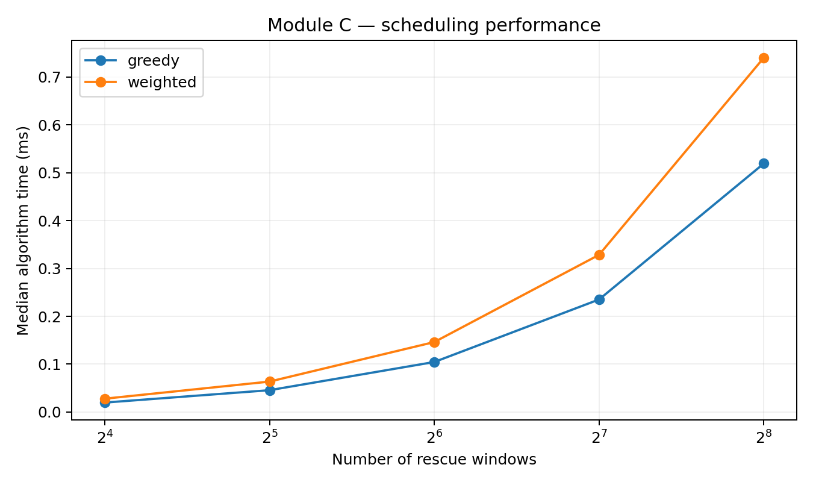
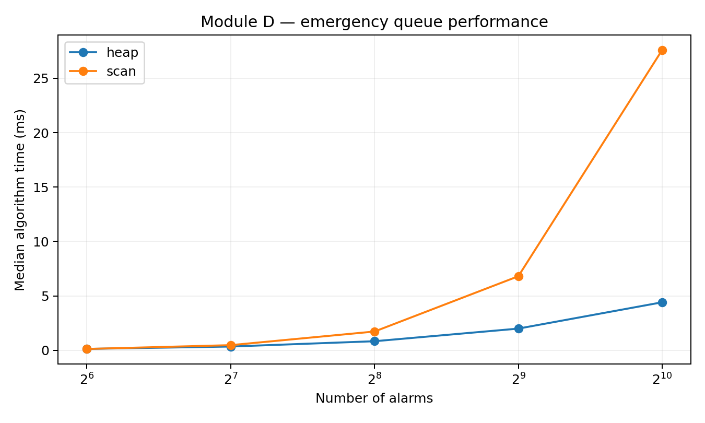
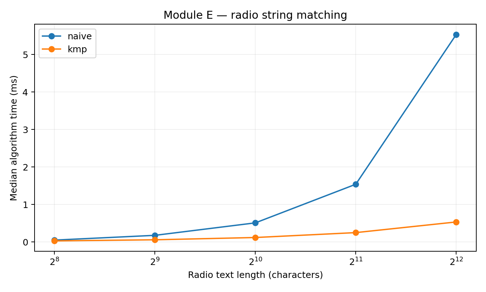
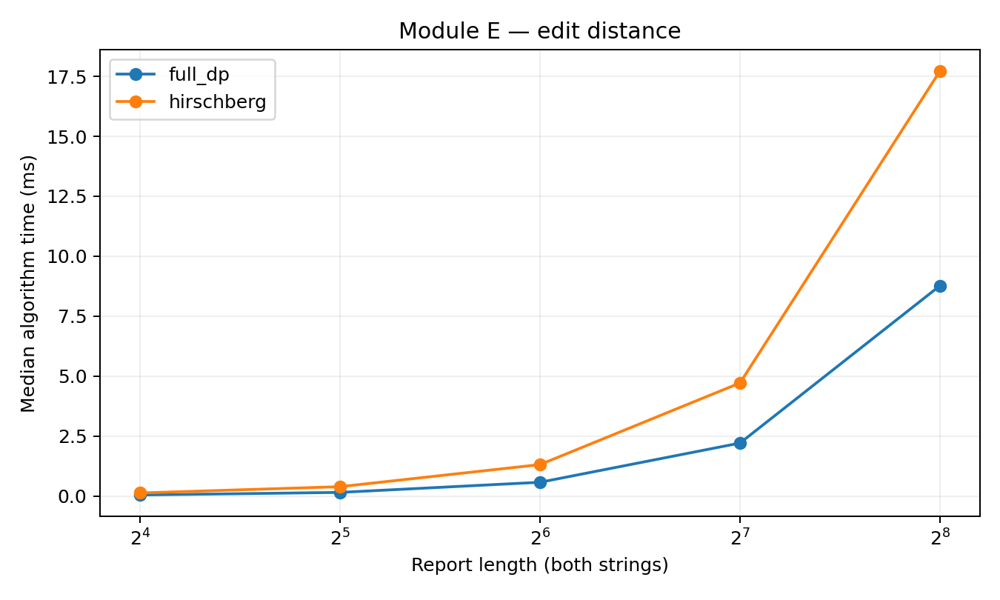
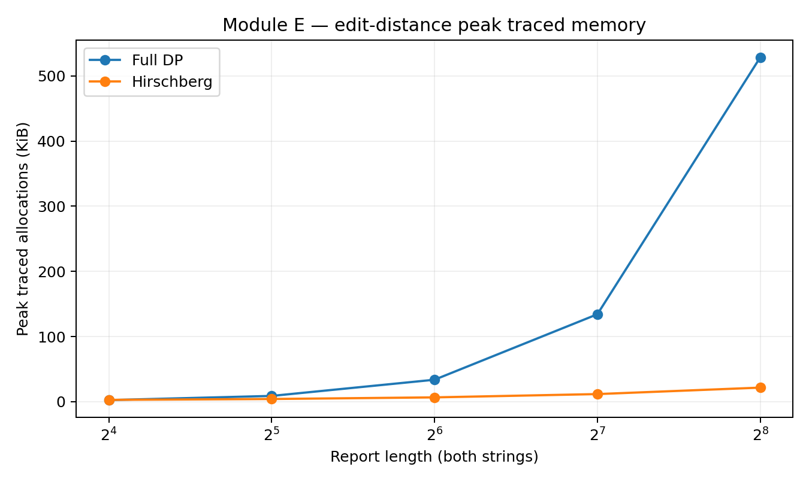
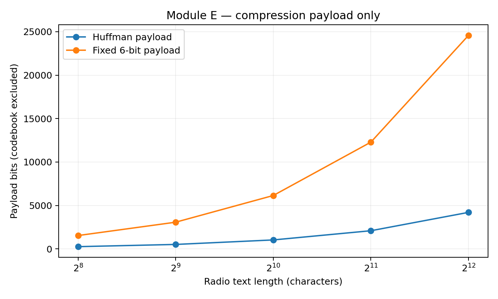

# Official Master-Release Experimental Findings — Modules C, D and E

**Contributor:** 23I-2521  
**Project:** Operation LIFELINE  
**Source commit:** `83aa7cd` on `sameer/phase2-c-d-e`  
**Measured source:** `results/results_sameer_master_benchmarks.csv`  
**Predeclared predictions:** `results/predictions_sameer.md`

## 1. Experimental provenance and protocol

The 20 CSV checksums in the `master_release_v1` archive were verified before case ingestion. Experiments use **official-data-derived prefixes** of case `1-40` (L) for scheduling, alarms, and edit distance, and case `1-49` (X trap) for radio matching and compression. Input construction/loading is outside the timed interval. These are not measurements of all full-size master cases, and they do **not** satisfy the broader master-order sampling and pooling requirement by themselves.

A total of 55 algorithm-size records were produced: **51 OK and 4 DNF**. Each OK row uses one discarded warm-up and five timed executions in a fresh process; `time_s` is the median and `time_iqr_s` is the difference between the fourth and second sorted measurements (the chosen IQR convention for five samples). Peak allocations (`mem_bytes`) were traced in a separate invocation with `tracemalloc` and exclude the preloaded input. The `ops` units are experiment-specific, collected separately, and are **not** directly comparable across families. The four DNF records are exhaustive scheduling at n=32, 64, 128, 256 under the **predeclared 18-window cap**, not actual 300-second timeouts.

## 2. Measured runtime tables

### C — Rescue scheduling

| Input size | greedy (ms) | weighted (ms) |
|---:|---:|---:|
| 16 | 0.0197 | 0.0278 |
| 32 | 0.0455 | 0.0635 |
| 64 | 0.1045 | 0.1462 |
| 128 | 0.2351 | 0.3285 |
| 256 | 0.5193 | 0.7405 |

At n=16, the exhaustive reference took **152.4434 ms** to enumerate 65,536 subsets versus **0.0278 ms** for weighted DP. It was capped (DNF) at the four larger sizes. Greedy maximizes compatible-window count; weighted DP maximizes total value, so the objectives are different and speed alone cannot decide which to use.



### D — Emergency alarms

| Input size | heap (ms) | scan (ms) |
|---:|---:|---:|
| 64 | 0.1240 | 0.1183 |
| 128 | 0.3405 | 0.4674 |
| 256 | 0.8283 | 1.7212 |
| 512 | 1.9896 | 6.8036 |
| 1024 | 4.4088 | 27.6009 |

At n=1,024, the heap took **4.4088 ms**, versus **27.6009 ms** for scanning (**6.26× faster**). Priority comparisons numbered **16,849** and **188,669**, respectively. At n=64 the scan was slightly faster (0.1183 vs 0.1240 ms); the heap improves as the backlog grows. Recorded peak traced memory was equal for both at n=1,024 (237,192 bytes), so these measurements do not establish an isolated heap-memory benefit.



### E — Radio matching

| Input size | naive (ms) | kmp (ms) |
|---:|---:|---:|
| 256 | 0.0500 | 0.0290 |
| 512 | 0.1770 | 0.0582 |
| 1024 | 0.5096 | 0.1189 |
| 2048 | 1.5393 | 0.2496 |
| 4096 | 5.5320 | 0.5334 |

The pattern length also rises across sizes (4, 8, 12, 20, 40). At n=4,096, KMP took **0.5334 ms** versus **5.5320 ms** for naive matching (**10.37× faster**). Character comparisons were **10,082** versus **142,332**, respectively. Both algorithms used the same released-case-derived input at each size.



### E — Edit distance

| Input size | full_dp (ms) | hirschberg (ms) |
|---:|---:|---:|
| 16 | 0.0405 | 0.1240 |
| 32 | 0.1473 | 0.3862 |
| 64 | 0.5699 | 1.3077 |
| 128 | 2.2053 | 4.7131 |
| 256 | 8.7712 | 17.7273 |

At length 256×256, full DP took **8.7712 ms** and Hirschberg took **17.7273 ms** (~**2.02×** slower). Full DP uses a complete matrix, whereas Hirschberg reconstructs an optimal script with row-based recursion.



### Edit-distance memory

| Both report lengths | Full DP (bytes) | Hirschberg (bytes) | Hirschberg memory reduction |
|---:|---:|---:|---:|
| 16 | 2,536 | 2,896 | -14.20% |
| 32 | 9,096 | 4,264 | 53.12% |
| 64 | 34,536 | 6,808 | 80.29% |
| 128 | 137,424 | 11,992 | 91.27% |
| 256 | 541,072 | 22,136 | 95.91% |

At length 16, Hirschberg uses slightly **more** traced memory. By length 256, Hirschberg uses **22,136 bytes** versus **541,072 bytes** for full DP: **95.91% less**. These figures are traced Python allocations during each invocation, not total process RSS. Hirschberg operation counts were not instrumented (the CSV correctly leaves them blank).



### E — Huffman versus fixed 6-bit encoding

| Input size | huffman (ms) | fixed6 (ms) |
|---:|---:|---:|
| 256 | 0.0283 | 0.0265 |
| 512 | 0.0560 | 0.0401 |
| 1024 | 0.1106 | 0.0687 |
| 2048 | 0.2322 | 0.1170 |
| 4096 | 0.4711 | 0.2219 |


| Text length | Huffman payload (bits) | Fixed 6-bit payload (bits) | Payload savings |
|---:|---:|---:|---:|
| 256 | 256 | 1,536 | 83.33% |
| 512 | 512 | 3,072 | 83.33% |
| 1,024 | 1,030 | 6,144 | 83.24% |
| 2,048 | 2,090 | 12,288 | 82.99% |
| 4,096 | 4,203 | 24,576 | 82.90% |

At 4,096 characters, Huffman reduced payload bits by **82.90%** excluding codebook storage, but encoding took **0.4711 ms** versus **0.2219 ms** for fixed-length (~**2.12×** slower). Case 1-49 is deliberately skewed and these payload savings are **not** a general claim about other distributions. A fair end-to-end compression ratio must include serialized codebook/header bits.



## 3. Growth fits and prediction comparison

The empirical model is `T(n) = A·n^p`, fitted by OLS to log time versus log size on the five recorded sizes. The table reports the fitted exponent p, an **illustrative** 95% t interval (df=3), R², and relative error of the **endpoint growth factor** against the committed asymptotic cost model: `100×(observed endpoint growth / predicted endpoint growth − 1)`. With only five nested-prefix sizes and possible system noise, these intervals quantify model-fit uncertainty, **not** broadly generalizable runtime confidence.

| Algorithm | Fitted p | 95% CI for p | R² | Endpoint growth error |
|---|---:|---|---:|---:|
| C greedy | 1.181 | [1.156, 1.207] | 0.9999 | -17.5% |
| C weighted | 1.184 | [1.171, 1.197] | 1.0000 | -16.7% |
| D heap | 1.285 | [1.184, 1.386] | 0.9982 | +33.4% |
| D scan | 1.960 | [1.918, 2.002] | 0.9999 | -8.8% |
| E naive | 1.670 | [1.567, 1.774] | 0.9989 | -30.8% |
| E KMP | 1.051 | [1.017, 1.084] | 0.9997 | +15.8% |
| E full DP | 1.942 | [1.901, 1.984] | 0.9999 | -15.3% |
| E Hirschberg | 1.793 | [1.693, 1.892] | 0.9991 | -44.2% |
| E Huffman | 1.017 | [0.986, 1.047] | 0.9997 | +4.1% |
| E fixed6 | 0.767 | [0.664, 0.870] | 0.9947 | -47.7% |

Prediction models used for endpoint growth are `n log2 n` (C greedy/weighted and D heap), `n²` (D scan, E edit/Hirschberg), `n × m` (E naive), `n + m` (E KMP), and `n` (E Huffman/fixed6). Here `m` is the recorded pattern length, which increases along with `n` for the matching experiments. Small constants, overheads, and input characteristics can account for departures from the idealized endpoint ratios; **the sign of an error is not an algorithmic correctness verdict**.

The fits qualitatively support the predictions: scheduling is close to n log n, scanning alarms is nearly quadratic (p=1.960), KMP is near linear in this family (p=1.051), full DP is nearly quadratic (p=1.942), and Huffman payload encoding is close to linear (p=1.017). The five-point Hirschberg time fit p=1.793 is below its quadratic worst-case asymptote, reflecting limited sizes and overhead, not a claim of subquadratic worst-case complexity. Likewise, fixed6 p=0.767 is a finite-size timing observation rather than a sublinear algorithm.

## 4. Recommendations and failure modes

1. **Use greedy earliest-finish selection for maximum rescue-window count and weighted interval DP when total rescue value matters.** Both scale well for measured sizes; exhaustive enumeration is a small-case correctness reference only. The objective mismatch is an important reversal condition.
2. **Use a binary max-heap for realistic alarm backlogs**, with the scan implementation as a simple baseline and test oracle. A tiny queue may favor the scan because of fixed overhead. Watch backlog length, total priority comparisons, release-tick latency, and tie correctness.
3. **Use KMP for radio-log matching when repeated prefixes/long patterns are plausible.** Naive matching remains simple for very small or easy inputs; watch actual text and pattern distribution, not just worst-case theory.
4. **Use full-matrix edit DP when memory is ample and runtime is critical; use Hirschberg when reports approach memory limits.** Both return optimal edit scripts in the verified tests; measure peak traced memory and elapsed time as report sizes grow.
5. **Use Huffman when skew is large and compression savings outweigh encode/decode and metadata overhead.** Measure the full serialized message including header/codebook; fixed6 is simpler and was faster for the measured sizes.

Top three risk areas for the overall engine, to monitor: (i) unreachable routes/road-closure handling, (ii) a long alarm backlog delaying urgent notifications, and (iii) capacity/large-input memory or runtime limits in exact optimizers. These are suggested operational risks, not empirically ranked by incident frequency.

## 5. Limits and submission follow-up

- **Sampling:** Five geometric sizes are derived from prefixes of just two master cases, not five independently sampled cases per tier or master-order positions 1,8,15,... across groups. If the course requires master-order sample-and-pool experiments, coordinate them with the group benchmark integrator.
- **Reproducibility:** Add the exact machine model/CPU, RAM, Python interpreter version, operating-system version, run timestamp, checksum manifest/archive identifier, and runner Git commit to the submission metadata. These values cannot be established from the CSV alone.
- **Full-size behavior:** Prefix measurements must not be reported as full-case outcomes; the separate `results/results_sameer_master_campaign.csv` records seven-day primary/baseline campaign outcomes for five complete cases.
- **DNF:** Four exhaustive attempts were predeclared unsupported and capped, rather than timed-out failures. Preserve the DNF rows and notes in consolidated results.
- **Operation counters:** Rescue reads, queue comparisons, KMP comparisons, full DP cells, and compression proxy counts have different units; Hirschberg counts are blank. Do not compare those raw `ops` values across families.
- **Memory:** `tracemalloc` peak allocations exclude preloaded inputs and cannot establish process-level peak RSS. Huffman saving excludes codebook/header cost.
- **Statistics:** Fit intervals are descriptive, especially with five nested prefix points and stable machine conditions. More independent master-order samples would improve robustness.

## Reproduction

```bash
python3 -m unittest discover -s tests -v
python3 -m benchmarks.benchmark_sameer_master --smoke
python3 -m benchmarks.benchmark_sameer_master | tee results/benchmark_sameer_master_run.log
```

**Data source:** `~/Downloads/archive.zip` (master_release_v1 ZIP) verified by `src.master_release` against bundled 20-table `CHECKSUMS.txt`. Reproducing full benchmarks overwrites `results/results_sameer_master_benchmarks.csv`, so preserve the committed run for audited comparisons.
